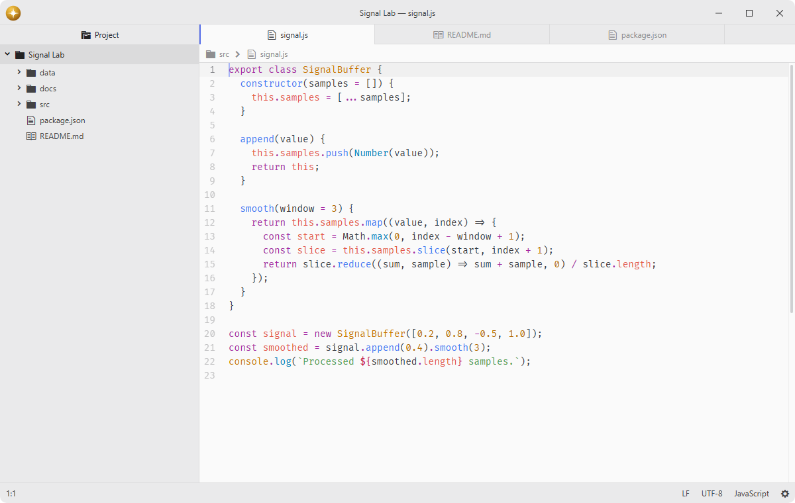

# tabs

Display a selectable tab for each open item in a pane.

Fork of [pulsar-edit/pulsar](https://github.com/pulsar-edit/pulsar) (`packages/tabs`).

## Features

- **Per-pane tabs**: shows a tab bar with a tab for every open editor and item in each pane.
- **Tab management**: close a single tab, other tabs, saved tabs, every tab in a pane, or every tab throughout the workspace.
- **Tab ordering**: move a tab one position left or right within its pane.
- **Split from a tab**: open a second copy of a tab up, down, left, or right in a new pane.
- **Window transfers**: move a tab into another window while keeping its unsaved text, selections, and scroll position.
- **File icons**: shows the icon an item names for itself, and a file-type icon when an icon package is installed.
- **File status coloring**: combine Git status with unsaved edits to tracked files, honoring Git ignore rules and undo before saving.



## Installation

To install `tabs` search for it in the Install pane of the Lumine settings, or run the command `lumine --install lumine-code/tabs`.

## Commands

Commands available in `lumine-workspace`:

- `tabs:move-tab-left`: move the target tab one position to the left,
- `tabs:move-tab-right`: move the target tab one position to the right,
- `tabs:detach-tab`: detach a tab into an additional window of the same workspace,
- `tabs:open-in-new-window`: move the target tab into a new window,
- `tabs:split-up`: copy the target tab into a pane above,
- `tabs:split-down`: copy the target tab into a pane below,
- `tabs:split-left`: copy the target tab into a pane to the left,
- `tabs:split-right`: copy the target tab into a pane to the right,
- `tabs:close-tab`: close the target tab,
- `tabs:close-other-tabs`: close all tabs except the target one,
- `tabs:close-tabs-to-right`: close all tabs to the right of the target tab,
- `tabs:close-tabs-to-left`: close all tabs to the left of the target tab,
- `tabs:close-saved-tabs`: close all tabs with no unsaved changes,
- `tabs:close-all-tabs`: close every tab in the pane,
- `tabs:close-all-tabs-in-workspace`: close every tab in every pane across all windows of the workspace.

## Usage

The Packages → Tabs menu and command palette act on the active tab. A tab's context menu acts on that tab. Close All Tabs closes the target pane's tabs; Close All Tabs in Workspace closes tabs across all windows of the workspace. Batch closing visits closable tabs one at a time and stops if a close is refused. Permanent dock tabs stay open.

Moving a tab keeps it in the same pane and preserves the selected tab. A tab at the edge cannot move farther in that direction.

Double-click a tab to toggle its pending preview state, or use `pane:toggle-pending-item` for the active tab. A pending tab is replaced when another item is opened in that pane; double-click it again to keep it open. Marking another tab pending keeps the previous preview open as a permanent tab. Editing or saving a preview makes it permanent.

Open in New Window moves the tab after the destination has accepted its contents. Dragging a tab between windows keeps its unsaved text, selections, and scroll position too. A move to an existing window is refused if that window has unsaved changes for the same file.

## Customization

Restyle the tabs by adding CSS to your `styles.css`. For example, to enlarge the labels and give the active tab a coloured underline:

```css
.tab-bar .tab {
  font-size: 13px;

  &.active {
    border-bottom: 2px solid #4c9aff;
  }
}
```

## Services

- `background-tips.provider`: provided to background-tips to describe tab management over an empty workspace.

## Contributing

Got ideas to make this package better, found a bug, or want to help add new features? Just drop your thoughts on GitHub. Any feedback is welcome!
